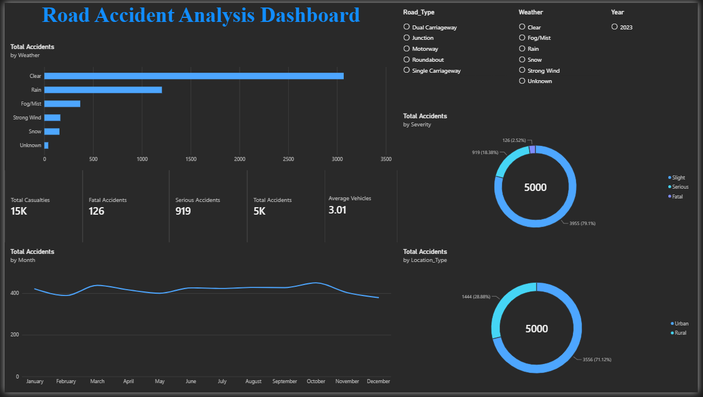

# Road Accident Analysis Dashboard

A data-cleaning and exploratory-analysis project with a Power BI report for exploring accident patterns by month, severity, weather, location, and road type.

> **Dataset note:** The included records are a recreated portfolio dataset, not records from a real accident investigation.

## Dashboard Preview



The Power BI report file is [`Road Accident Analysis Dashboard.pbix`](Road%20Accident%20Analysis%20Dashboard.pbix).

## Project Contents

| File | Description |
| --- | --- |
| `accident_analysis.py` | Cleans the raw data, derives date/time fields, and creates analysis outputs. |
| `road_accident_raw.csv` | Source portfolio dataset, including missing categorical values and duplicate rows for the cleaning workflow. |
| `road_accident_cleaned.csv` | Deduplicated, cleaned dataset for Power BI. |
| `road_accident_cleaned.xlsx` | Excel export of the cleaned dataset. |
| `Road Accident Analysis Dashboard.pbix` | Power BI report containing the dashboard. |
| `PowerBI_Measures.txt` | DAX measures used in the report. |
| `*_summary.csv` | Severity, monthly, weather, and location summary outputs. |

## Run the Analysis

Requirements: Python 3, pandas, matplotlib, and openpyxl.

From this project folder, install the packages and run the script:

```bash
python -m pip install pandas matplotlib openpyxl
python accident_analysis.py
```

The script reads `road_accident_raw.csv` from the current folder. It removes duplicate rows, fills missing weather and road-surface values with `Unknown`, converts the date and time fields, and derives year, month, day, hour, and time-period columns. It writes the cleaned CSV and Excel file, plus severity, monthly, weather, and location summaries, into the same folder.

## Power BI

Open `Road Accident Analysis Dashboard.pbix` in Power BI Desktop. The report includes KPI cards for total accidents, casualties, serious and fatal accidents, and average vehicles involved, along with monthly, severity, weather, and location visuals. Slicers are available for year, weather, and road type.

The source DAX measures are documented in [`PowerBI_Measures.txt`](PowerBI_Measures.txt). To refresh the report after rerunning the script, refresh the data in Power BI Desktop and save the `.pbix` file.

## Data Quality

The raw file contains 5,025 rows, including 25 duplicate rows. The cleaned output contains 5,000 rows. Missing values in `Weather` and `Road_Surface` are retained as the explicit category `Unknown` for analysis.

This project demonstrates a reproducible data-cleaning and dashboard workflow. Do not present the recreated records as real-world accident data.
